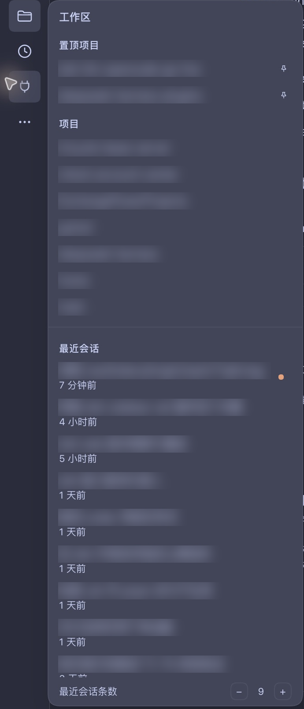
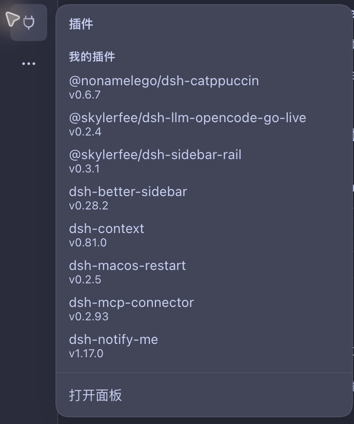
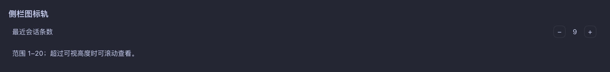

**[English](README.md)** | [简体中文](README.zh.md)

# dsh-sidebar-rail

[](https://github.com/SkylerFee/dsh-sidebar-rail/actions/workflows/ci.yml)
[](https://www.npmjs.com/package/@skylerfee/dsh-sidebar-rail)
[](#support)
[](LICENSE)

Reach workspaces, recent sessions, scheduled tasks, plugins and your account while the DeepSeek Harness sidebar is collapsed on macOS Desktop.

The rail starts hidden. Collapse the host sidebar, then move the pointer into the 12px strip along the window's left edge to reveal a 56px icon rail. Hover an icon to browse its flyout and choose an entry to navigate. Expanding the sidebar keeps the host's search, workspace tree, account menu and settings.

<a id="screenshots"></a>
## Screenshots

These cropped screenshots show the real macOS Desktop client in Chinese, with a dark appearance and the Catppuccin skin. Workspace names and session titles are blurred. Recent count is set to 9 in the images; its default remains 5.

<table>
  <tr><th>Workspaces, pins and recent sessions</th><th>My plugins</th></tr>
  <tr>
    <td valign="top"></td>
    <td valign="top"></td>
  </tr>
</table>

## Navigation

[Screenshots](#screenshots) · [Install and manage](#install) · [Usage](#usage) · [Preferences and local data](#preferences) · [Troubleshooting](#troubleshooting) · [Development and contributions](#development) · [Documentation](#docs)

<a id="support"></a>
## Support

| Environment / state | Behaviour |
| --- | --- |
| macOS Desktop, sidebar collapsed, viewport width ≥ 768px | Hidden rail, revealed by the edge strip or keyboard focus |
| macOS Desktop, sidebar collapsed, viewport width < 768px | No rail; the host button still expands the sidebar |
| macOS Desktop, sidebar expanded | No rail; the host sidebar remains available |
| Web, any platform | No rail; the host keeps its existing collapsed rail |
| Windows / Linux Desktop | No rail; support is untested |

Recorded Desktop checks used macOS Desktop `0.2.2-rc.1`. See `peerDependencies` in [package.json](package.json) for other compatible host versions. Some new settings and balance displays still have unverified paths; see the [verification log](docs/verify.md). Source development and checks require Node.js ≥ 22.19.0, with no dependency installation or build step.

<a id="install"></a>
## Install and manage

Ask the assistant in DSH to install `@skylerfee/dsh-sidebar-rail`. A profile with plugin management enabled can call `plugin_manager` with these arguments; this is a tool request, not a terminal command:

```json
{
  "action": "install_bundle",
  "target": "@skylerfee/dsh-sidebar-rail"
}
```

For local development, replace `target` with this repository's absolute path. Installation affects the current profile. Follow the result's `nextStep` for a refresh or restart, then confirm that Sidebar rail is enabled and its component is running in the plugin manager.

| Operation | `plugin_manager` arguments |
| --- | --- |
| Disable | `action: "set_bundle"`, `target: "@skylerfee/dsh-sidebar-rail"`, `enabled: false` |
| Enable again | Same request with `enabled: true` |
| Uninstall | `action: "remove_bundle"`, `target: "@skylerfee/dsh-sidebar-rail"` |

The host plugin manager also provides an enable switch. Local preferences remain after disabling or uninstalling the plugin.

<a id="usage"></a>
## Usage

1. Collapse the sidebar with the host button. Move the pointer to the window's left edge, below the window controls, to reveal the rail.
2. Hover an icon for about 120ms to open its flyout. Leaving closes the flyout after about 200ms. Moving between rail icons switches the flyout without retracting the rail.
3. Choose an entry to navigate and retract the rail. Expand the host sidebar for native search, settings or workspace management.

| Entry | Available actions |
| --- | --- |
| Workspaces | Browse pinned projects and projects by name; choose a name to switch workspace or use the pin button to pin or unpin it |
| Recent sessions | Scroll independently at the foot of the workspace flyout, newest first, excluding archived, blank and subagent sessions; open an existing session and see its relative time and host-provided status mark |
| Scheduled tasks | Browse tasks that have not ended or paused; choose a row or Open panel to enter the task panel |
| My plugins | Browse bundles you installed and enabled, excluding host bundles; choose a row to enter the plugin manager |
| More | Open other host panels or expand the native sidebar |
| Account and settings | See the host avatar and available balances, bonuses, View usage and Top up links; signed-out accounts get a hint; the flyout also names the path to the host Settings panel (expand the sidebar, then Settings at its foot); sign-in, sign-out and payment remain in the host or destination page |

Keyboard: `Tab` to an icon reveals the rail. On a top-row function icon, press `↓` or `→` to enter its flyout, then `Tab` through the list. `Escape` inside the flyout closes it and returns focus to its trigger. `Enter` activates the focused button like a click; activating an icon navigates directly rather than entering its flyout list.

<a id="preferences"></a>
## Preferences and local data

Recent count defaults to **5**, with a range of **1–20**. Adjust it with the stepper at the foot of the workspace flyout or on the plugin detail page. Recent sessions scroll independently when they exceed the visible height.



Preferences belong to this client and use `localStorage['dsh.sidebar-rail.v1']`:

| Field | Purpose |
| --- | --- |
| `pinnedWorkspaceIds` | Pinned workspace IDs, most recently pinned first |
| `recentCount` | Number of recent rows, normalised to an integer from 1 to 20; unparseable values use the default |

The host owns the collapse state; the plugin only reads it. Account and balance data come from host services and are not written to these preferences. Clearing client storage loses local settings. Both settings surfaces share this preference; see the [verification log](docs/verify.md) for real Desktop checks of immediate synchronisation between them.

<a id="troubleshooting"></a>
## Troubleshooting and limitations

| Symptom | Check or recovery |
| --- | --- |
| No rail after installation | Confirm macOS Desktop, the enabled plugin, a collapsed sidebar and viewport width ≥ 768px; the rail starts hidden and needs the left-edge strip |
| A recent session is missing | Check Recent count; archived, blank and subagent sessions are excluded |
| Task or plugin loading fails | Missing services, structured failures and requests exceeding 5s enter the failure state; use Open panel for the host page, or close and reopen the flyout to retry |
| No avatar or balance | A missing avatar uses a fallback glyph; unavailable balances get a hint. Account data are read on component mount and are not guaranteed to refresh live; use the host account page for full details |
| A revealed rail covers the page's left edge | It is a temporary overlay that reserves no host grid space; the hidden default preserves the conversation tab entry, and moving the pointer away lets the rail retract |
| Sidebar rail unavailable or a boot import error | Keep the visible error and host diagnostics, disable the plugin through the native sidebar, and report the host version, plugin version and reproduction steps in this repository; omit credentials and conversation content |

The plugin keeps the expanded host sidebar and its column width. The top 48px remain clear for macOS window controls; reduced-motion preferences are respected. For light themes, other platforms, real remote failures, plugin-detail settings interactions and the primary balance row on a funded account, rely on the actual results and unverified items in the [verification log](docs/verify.md).

<a id="development"></a>
## Development and contributions

```bash
npm test               # Pure logic and client factory registration tests
npm run check          # Repository rules, syntax checks for both entries, and tests
npm run hooks:install  # Optional: enable this repository's commit hooks
```

The client is a hand-written static module with no dependency installation or build step. Tests extract pure functions from the `#region` sections of `client.js`; the registration test requires the factory ID to match the full scoped package name. These checks do not replace real Desktop validation.

Use Conventional Commits for PR titles, with the summary, description and verification results in Simplified Chinese. Keep code identifiers and original diagnostics in English. Follow the [PR template](.github/pull_request_template.md) for the problem, changes, validation and unverified items; update both README languages when behaviour changes. UI, loading or registration changes require real environment and operation results in [docs/verify.md](docs/verify.md). See [AGENTS.md](AGENTS.md) and [CODING_STANDARDS.md](CODING_STANDARDS.md) for the full rules.

Follow [ADR-0003](docs/adr/0003-release-pipeline.md) to release: update and push the version, then create a GitHub Release tagged `v<version>`. `publish.yml` validates it and uses npm OIDC trusted publishing; the npm Trusted Publisher must allow direct publishing.

<a id="docs"></a>
## Documentation

| Document | Content |
| --- | --- |
| [Product requirements](docs/PRD.md) | Use cases, interactions and acceptance criteria |
| [Design](docs/design.md) | Additive registration, layout, data sources, cleanup and local storage |
| [Verification log](docs/verify.md) | Recorded results, historical defects and unverified paths |
| [0.2.0 audit report](docs/desktop-audit-0.2.0-2026-11-04.md) | Findings and reproduction evidence from that version; later verification entries track fixes |
| [Glossary](GLOSSARY.md) | Shared terms for the rail, sidebar, flyout and current session |
| [Architecture decisions](docs/adr/) | Narrow-window eligibility, zero dependencies and release workflow |

## License

MIT © 2026 SkylerFee. See [LICENSE](LICENSE).

[](https://github.com/deepseek-ai/deepseek-harness)
