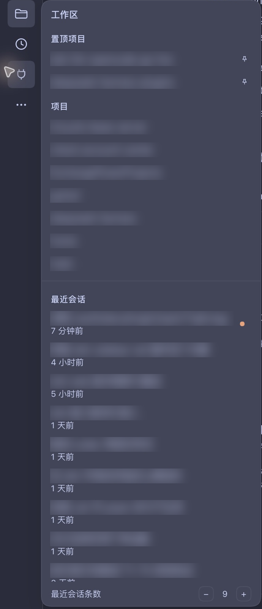
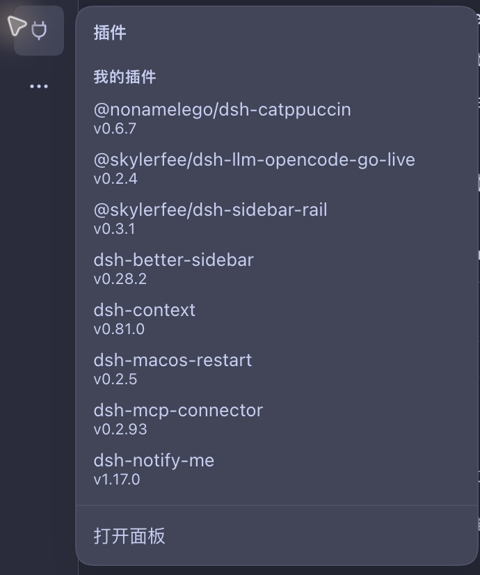

[English](README.md) | **[简体中文](README.zh.md)**

# dsh-sidebar-rail

[](https://github.com/SkylerFee/dsh-sidebar-rail/actions/workflows/ci.yml) [](LICENSE) [](https://nodejs.org) [](https://github.com/SkylerFee/dsh-sidebar-rail/releases) [](https://www.npmjs.com/package/@skylerfee/dsh-sidebar-rail) [](https://awesome-dsh-plugin.com)

给 DeepSeek Harness 的 macOS Desktop 折叠侧栏补充工作区、最近会话、定时任务、插件和账号入口。

图标轨默认隐藏。收起宿主侧栏后，将指针移到窗口左缘的 12px 热区，就会滑出一条 56px 图标轨；悬停图标可查看浮层，点击条目即可导航。展开侧栏时，搜索、工作区树、账号菜单和设置继续使用宿主原生界面。

<a id="screenshots"></a>
## 界面预览

以下为 macOS Desktop 中文界面、深色外观与 Catppuccin 皮肤下的真实局部截图。工作区名称和会话标题已模糊处理；图中最近会话条数为 9，默认值仍为 5。

<table>
  <tr><th>工作区、置顶与最近会话</th><th>我的插件</th></tr>
  <tr>
    <td valign="top"></td>
    <td valign="top"></td>
  </tr>
</table>

## 导航

[界面预览](#screenshots) · [安装与启停](#install) · [使用方法](#usage) · [设置与本地数据](#preferences) · [常见问题](#troubleshooting) · [开发与贡献](#development) · [详细文档](#docs)

<a id="support"></a>
## 支持范围

| 环境 / 状态 | 行为 |
| --- | --- |
| macOS Desktop，侧栏折叠，视口宽度 ≥ 768px | 默认隐藏图标轨，由左缘热区或键盘焦点唤出 |
| macOS Desktop，侧栏折叠，视口宽度 < 768px | 不渲染图标轨；仍可用宿主按钮展开侧栏 |
| macOS Desktop，侧栏展开 | 不渲染图标轨，保留原生侧栏 |
| Web（任意平台） | 不渲染图标轨，保留宿主已有的折叠轨 |
| Windows / Linux Desktop | 不渲染图标轨，未验证支持 |

已记录的真机环境为 macOS Desktop `0.2.2-rc.1`；其他宿主版本的兼容范围见 [package.json](package.json) 的 `peerDependencies`。部分新设置与余额显示尚有未验证项，见[验证记录](docs/verify.md)。发布包内是已构建的 `lib/` 入口，安装时不需要编译器；源码开发与检查需要 Node.js ≥ 22.19.0，并要先 `npm ci`、再构建（见[开发与贡献](#development)）。

<a id="install"></a>
## 安装与启停

需要 DSH 的 **Desktop 或 Web 客户端**，以及可用的 profile。安装只影响当前 profile，不改动 DSH 本身。

### 方式一：插件管理页（推荐）

在 DSH 侧栏进入 **插件** 页，点右上角 **添加插件**，在「包名或地址」里填入后按 **安装**：

```
@skylerfee/dsh-sidebar-rail
```

该输入框接受 npm 包名、Git 仓库地址和本地目录，本插件用 npm 包名即可。安装完成后按提示重启或刷新 DSH，再确认「侧栏图标轨」处于启用状态。

npm 包内是预构建的 `lib/index.js` 与 `lib/client.js`，安装或升级都不需要编译器，消费方 profile 里也不需要有构建步骤。若改为直接从 Git 源码安装，则依赖目标包管理器允许执行本仓库的构建脚本；不允许时请在本地构建或改用已发布的 tarball。

### 方式二：命令行

```sh
dsh plugin --profile desktop add @skylerfee/dsh-sidebar-rail
```

`dsh plugin` 会把参数转交给 profile 目录里的 pnpm；把 `desktop` 换成你实际使用的 profile 名，首次使用会自动初始化。也可以直接进 profile 目录执行 `pnpm add`。装完重启 DSH 生效。

### 方式三：在对话里让助手安装

启用插件管理工具的 profile 可以让助手代为安装（这是工具参数，不是终端命令）：

```json
{
  "action": "install_bundle",
  "target": "@skylerfee/dsh-sidebar-rail"
}
```

本地开发时把 `target` 换成本仓库的绝对目录，即安装一条 `link:` 依赖，profile 会加载该目录当前的 `lib/`。首次先执行 `npm ci`，改完 `src/` 后跑 `npm run build`（或保持 `npm run dev` 的 watch），再重启 DSH。

### 启停与卸载

启停是 profile 配置层的开关，用插件管理页；命令行只能装卸包。

| 操作 | 做法 |
| --- | --- |
| 停用 | 插件管理页关掉「侧栏图标轨」开关（保留已装依赖，随时可再打开） |
| 重新启用 | 打开同一个开关 |
| 卸载 | 插件管理页进入详情页点 **卸载**，或执行 `dsh plugin --profile desktop remove @skylerfee/dsh-sidebar-rail` |

也可以让助手调用 `plugin_manager` 的 `set_bundle`（启停）或 `remove_bundle`（卸载）。停用或卸载后，`localStorage` 里的本地偏好（置顶项目、最近会话条数）仍保留。

<a id="usage"></a>
## 使用方法

1. 用宿主按钮收起侧栏，将指针移到窗口左缘、顶部窗口控件下方，唤出图标轨。
2. 在图标上停留约 120ms 打开浮层；移出后约 200ms 关闭浮层。在轨内切换图标只切换浮层。
3. 点击条目完成导航，图标轨随导航收起；需要原生搜索、设置或工作区管理时，展开宿主侧栏。

| 入口 | 可执行的操作 |
| --- | --- |
| 工作区 | 三个分区——置顶项目 / 项目 / 最近会话。项目行可展开它的会话列表（不过滤、宿主顺序），并可新建会话；「添加项目」登记目录但不跳转 |
| 最近会话 | 在工作区浮层底部独立滚动，按更新时间倒序显示，排除归档、空白与子代理会话；点击打开已有会话，显示相对时间及宿主提供的会话状态标识 |
| 定时任务 | 三个分区——进行中 / 已暂停 / 已结束，只默认展开「进行中」；点击条目或「打开面板」进入任务面板 |
| 我的插件 | 两个分区——已启用 / 未启用（已安装但关闭的），过滤宿主内置包，不提供开关；点击进入插件管理面板 |
| 更多 | 查看宿主其他面板入口，或展开原生侧栏 |
| 账号与设置 | 显示宿主账号头像，以及可用的余额、赠金、「查询用量」「充值」链接；未登录时显示提示；并给出「展开侧栏后点左下角设置」的路径说明；登录、退出和付款由宿主或目标网页处理 |

键盘操作：用 `Tab` 聚焦图标，轨会随焦点出现。聚焦顶部功能图标后，按 `↓` 或 `→` 进入对应浮层，再用 `Tab` 遍历列表；在浮层内按 `Escape` 关闭并返回触发按钮。`Enter` 激活聚焦按钮，与点击语义相同；在图标上激活会直接导航，不等同于进入浮层列表。

<a id="preferences"></a>
## 设置与本地数据

「最近会话条数」默认 **5**，可设置为 **1–20**。工作区浮层底部提供加减按钮，插件详情页也提供同一设置。

每个浮层都从窗口 chrome 带之下占满到窗口底，并按分区组织：一行不随内容滚动的标题，加上一块独立滚动的列表。每个分区最高可长到可用高度的 1/3，超出后自己滚动，内容少时保持自然高度而不强行撑满。分区可以收起，收起不会改变浮层总高度。


偏好保存在当前客户端的 `localStorage['dsh.sidebar-rail.v1']`：

| 字段 | 用途 |
| --- | --- |
| `pinnedWorkspaceIds` | 已置顶工作区的 ID，最近置顶的排在前面 |
| `recentCount` | 最近会话显示条数，规范化为 1–20 的整数，无法解析时使用默认值 |

折叠状态由宿主持有，插件只读；账号与余额通过宿主服务读取，不写入这份偏好。清除客户端存储会丢失这些本地设置。两个设置入口共享该偏好，跨入口即时同步的真机验收情况见[验证记录](docs/verify.md)。

<a id="troubleshooting"></a>
## 常见问题与限制

| 现象 | 检查或处理 |
| --- | --- |
| 安装后看不到图标轨 | 确认使用 macOS Desktop、插件已启用、侧栏已折叠、视口宽度 ≥ 768px；轨默认隐藏，需要将指针移到左缘热区 |
| 看不到最近的某个会话 | 检查条数设置；归档、空白和子代理会话不会进入列表 |
| 任务或插件加载失败 | 服务缺失、结构化失败或请求超过 5s 会进入失败态；用「打开面板」查看宿主页面，或关闭后重开浮层重试 |
| 账号没有头像或余额 | 无头像时使用占位图标；余额不可用时显示提示。账号数据在组件挂载时读取，不保证实时刷新，完整信息以宿主账号页为准 |
| 图标轨展开时覆盖页面左侧 | 它是浮在正文上的临时层，不占宿主栅格宽度；默认隐藏用于保留会话页「对话」标签的入口，可移开指针让轨收起 |
| 出现 `Sidebar rail unavailable` 或启动导入错误 | 保留界面错误与宿主诊断日志，通过原生侧栏进入插件管理停用，并在本仓库反馈宿主版本、插件版本和复现步骤；不要附凭据或会话正文 |

插件不接管展开态侧栏，不修改宿主列宽。顶部 48px 留给 macOS 窗口控件；支持减少动态效果的系统偏好。浅色主题、其他平台、真实 remote 故障、插件详情页设置交互和有余额账号的主余额行，以[验证记录](docs/verify.md)中的实际结果与未验证项为准。

<a id="development"></a>
## 开发与贡献

```bash
npm ci                 # 按 package-lock.json 安装开发工具链
npm run typecheck      # tsc --noEmit，对 src/ 与测试做严格类型检查
npm run build          # esbuild 生成 lib/index.js 与 lib/client.js
npm run dev            # 同一构建的 --watch 模式
npm run test:unit      # 由 tsx 直接跑 test/*.test.ts，导入 src/ 源码
npm run test:artifact  # Node 跑 test/*.test.mjs，消费已构建的 lib/
npm test               # 单测 → 构建 → 产物测试
npm run check:source   # 源码规则与字典检查
npm run check:artifact # 入口、文件白名单、外部模块与注册元数据检查
npm run check          # 类型检查 → check:source → test:unit → 构建 → check:artifact → 产物测试
npm run hooks:install  # 可选：启用本仓库的提交钩子
```

脚本以 [package.json](package.json) 为准，上面与之一致。源码在 `src/`，按职责拆成 TypeScript / TSX 模块，esbuild 只做转换与打包、不做类型检查。`lib/` 是生成目录，不提交 Git，改完 `src/` 必须重新构建，因此本地 checkout 不再「改完即生效」。运行时依赖仍为零：客户端只向宿主 `require` `react` 与 `react-dom`。注册测试检查工厂 ID 与完整作用域包名一致；这些检查不能替代 Desktop 真实界面验收。

PR 标题遵循 Conventional Commits，摘要、说明与验证结果使用简体中文，代码标识符和原始诊断保留英文。按 [PR 模板](.github/pull_request_template.md)填写问题、改动、验证与未验证项；中英文 README 的行为描述同步维护。UI、加载或注册变更需在 [docs/verify.md](docs/verify.md) 记录真实环境与操作结果。详细约束见 [AGENTS.md](AGENTS.md) 和 [CODING_STANDARDS.md](CODING_STANDARDS.md)。

发布按 [ADR-0003](docs/adr/0003-release-pipeline.md)：更新版本并推送后，创建 `v<version>` 的 GitHub Release，由 `publish.yml` 校验并使用 npm OIDC 信任发布；npm 端需配置允许直接发布的 Trusted Publisher。发布执行的是 `npm publish --ignore-scripts`，不会在发布流程里触发构建：创建 Release 之前必须已完成 `npm ci` 与完整 `npm run check`（其中包含构建与 `lib/` 校验）。

<a id="docs"></a>
## 详细文档

| 文档 | 内容 |
| --- | --- |
| [产品需求](docs/PRD.md) | 使用场景、交互规格与验收清单 |
| [设计说明](docs/design.md) | 增量挂载、布局、数据来源、清理与本地存储 |
| [验证记录](docs/verify.md) | 各轮真实结果、历史缺陷与未验证项 |
| [0.2.0 审查报告](docs/desktop-audit-0.2.0-2026-11-04.md) | 当时发现的问题与复现证据，修复进展见后续验证记录 |
| [术语表](GLOSSARY.md) | 轨、侧栏、浮层、当前会话等统一用词 |
| [TypeScript 迁移指南](docs/typescript-migration.md) | 模块划分、构建协议、测试迁移与分阶段计划 |
| [架构决策](docs/adr/) | 窄窗判定、TypeScript 源码与构建工具链（[ADR-0006](docs/adr/0006-typescript-source-and-build.md)）、发布流程 |

## 许可证

MIT © 2026 SkylerFee，见 [LICENSE](LICENSE)。

[](https://github.com/deepseek-ai/deepseek-harness)
