# 使用指南

本文对应 0.4.0 版本（2026-11-11 的源码提交 `de05173`）。0.4.0 尚未发布到 npm；安装其他已发布版本时，请以该版本的实际能力为准。安装与启停见 [README](../README.zh.md#install)，本轮实测结论及未验证项见[验收报告](desktop-audit-2026-11-11.md)。

截图拍摄于 2026-11-11，宿主为 macOS Desktop `0.2.2-rc.1`、中文界面，浅色使用 **Catppuccin Latte**，深色使用 **Catppuccin Frappé**。下方每组保留整个图标轨和所示浮层边界；长列表分别展示顶部与滚动末尾。业务名称与金额已模糊，非插件主页面已遮蔽，控件、时间、分组、状态图标与操作入口未重绘。图片可点击查看原尺寸；[截图清单](images/README.md)记录场景和覆盖范围。

## 唤出与收起

在 **macOS Desktop、宿主侧栏已折叠、视口宽度至少 768px** 时，图标轨默认藏在窗口左侧。先激活 DSH 窗口，再把指针移到顶部窗口控件下方的 **12px 左缘热区**，即可唤出 **56px 图标轨**。

从上到下依次是工作区、定时任务、插件、更多，账号与设置在底部。悬停图标约 120ms 打开对应浮层；移开约 200ms 关闭。点击会话或面板条目完成导航，并收起图标轨。点击顶部图标会直接打开宿主侧栏或对应面板，与悬停查看浮层的用途不同。

切换到其他应用后，轨应收起；回到 DSH 后需要重新移入热区或用键盘聚焦来唤出。展开宿主侧栏、缩窄到 768px 以下或使用 Web 客户端时，插件不显示轨，继续使用宿主导航。

截图中的图标轨处于已经唤出的状态；它默认隐藏，不是常驻侧栏。当前浮层并未达到规格要求的全高，短浮层下方的留白是真实表现，详见验收报告。

## 工作区与项目

工作区浮层按「置顶项目 → 项目 → 最近会话」排列。点分区标题可以折叠或展开该组。

| 控件 | 操作与结果 |
| --- | --- |
| 项目名称 / 文件夹 | 点击整行展开或收起项目内的会话；文件夹图标跟随展开状态变化 |
| 项目行右侧 `+` | 在该项目下进入新会话；不会同时切换项目展开状态 |
| 项目行右侧图钉 | 置顶或取消置顶；置顶后移到上方分区，不在普通项目区重复出现，最近置顶的排在前面 |
| 「项目」标题右侧 `+` | 选择已有目录并登记为项目；不创建磁盘目录，也不自动跳转到该项目。取消选择不登记；失败时显示提示，可改用宿主添加入口 |
| 项目会话 | 保留宿主成员顺序；归档成员仍可列出并标注归档；缺失摘要的成员不生成占位节点 |

没有可显示会话的项目会显示空态提示。项目展开状态与置顶列表保存在当前客户端，关闭浮层或刷新后仍保留；**分区折叠状态不保存**，关闭重开回到默认。

**工作区总览**：三分区、项目行的文件夹 / 新建 / 图钉，以及「添加项目」入口。最近会话的后半部分需向下滚动，见下一节。

<table>
  <tr><th>浅色 · Latte</th><th>深色 · Frappé</th></tr>
  <tr>
    <td><a href="images/workspace-light.png">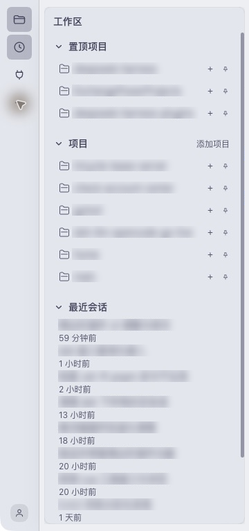</a></td>
    <td><a href="images/workspace-dark.png">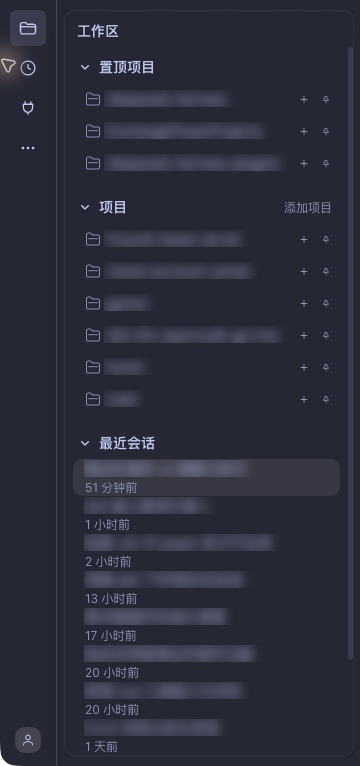</a></td>
  </tr>
</table>

**项目展开**：文件夹变为打开态，子会话按宿主顺序列出，列表末尾有独立的「显示更多」。本轮实测关闭重开仍保留项目展开状态，分页回到初始水位；刷新持久化只由离线存储测试覆盖。

<table>
  <tr><th>浅色 · 项目会话</th><th>深色 · 项目会话</th></tr>
  <tr>
    <td><a href="images/project-light.png">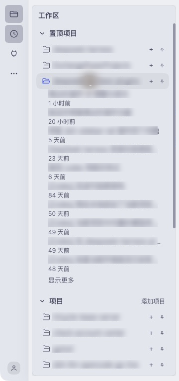</a></td>
    <td><a href="images/project-dark.png">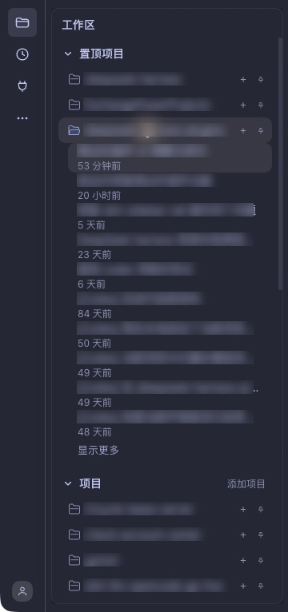</a></td>
  </tr>
</table>

## 最近会话、分页与标记

最近会话按更新时间倒序，显示相对时间，并突出主视图当前会话。归档和子代理会话不进入最近列表。最近列表与项目展开列表都只保留**当前正在打开的空白会话**，其他空白会话隐藏，真实数据不会删除。

列表默认显示 **10 条非空会话**，末尾的「显示更多」每次再加 10 条；全部显示后按钮消失。最近会话与每个项目各自计数。最近会话中的运行中、等待操作、完成未读、当前会话等条目可以自动提高显示水位；项目展开列表只按当前会话提高水位。自动提升上限为 50，更靠后的条目需点「显示更多」。当前空白会话始终显示且不占普通条数，因此初次打开不一定恰好只有 10 行。

分页状态只在浮层本次打开期间有效，关闭重开恢复默认水位。旧版的「最近会话条数」步进器和插件详情页设置块已移除。

会话行的 **时钟**表示该会话涉及进行中的定时任务；当前版本实际显示在**行尾**，与规格的行首位置不一致。该行有运行、未读或等待操作等状态点时优先显示状态点。任务列表尚未加载或取数失败时不显示时钟，仍可浏览会话。点时钟本身不会打开会话；点会话标题才会导航。标记位置及互斥规则的验证边界见验收报告。

长列表在同一个内容区里整体滚动，分区标题随内容滚走。「显示更多」随列表滚动，不占固定底栏。浮层高度的规格与当前实测差异见[验收报告](desktop-audit-2026-11-11.md)。

**最近会话滚动末尾**：截图完整显示本页 10 条会话和「显示更多」，最后一行右侧可见时钟。本轮点击「显示更多」实测增加至 20 条；截图保留点击前的按钮与时钟，方便定位。

<table>
  <tr><th>浅色 · 最近会话与分页</th><th>深色 · 最近会话与分页</th></tr>
  <tr>
    <td><a href="images/recent-light.png">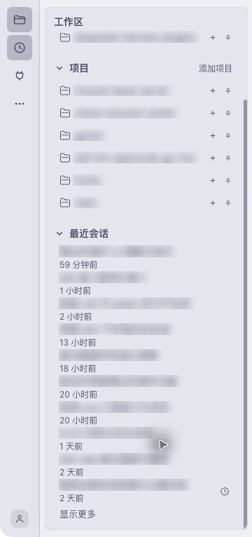</a></td>
    <td><a href="images/recent-dark.png">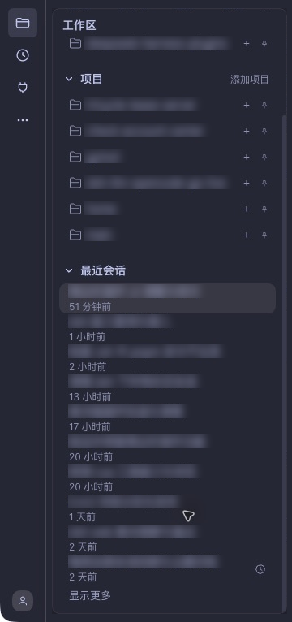</a></td>
  </tr>
</table>

## 定时任务

任务浮层按「进行中 / 已暂停 / 已结束」分组，默认只展开「进行中」。条目显示任务名称与宿主提供的运行时间信息。

点击任务条目或底部「打开面板」进入宿主任务面板，不会直接运行、暂停或删除任务，也不承诺定位某条任务的详情。编辑与管理操作在宿主面板完成。

服务缺失、返回失败或请求超过 5 秒时应显示失败提示，成功但没有任务时显示空态。当前版本的快速切换加载问题及默认收起分区的点击限制见[验收报告](desktop-audit-2026-11-11.md)；遇到加载不结束，可先关闭浮层再重开。

**默认态**：仅「进行中」展开，底部保留「打开面板」。本轮两个活跃任务名称已脱敏，计划时间保留。

<table>
  <tr><th>浅色 · 默认分组</th><th>深色 · 默认分组</th></tr>
  <tr>
    <td><a href="images/tasks-default-light.png">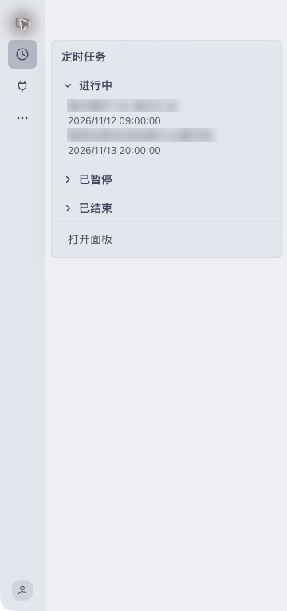</a></td>
    <td><a href="images/tasks-default-dark.png">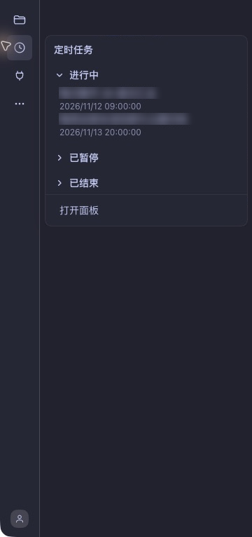</a></td>
  </tr>
</table>

**展开全部分组**：展示暂停 / 结束分类的空态和底部入口。本轮这两个分类没有真实条目，不能把空态截图当作已验证暂停 / 结束任务行。默认收起的分区需要点两次才展开（已知 K2）。这是**已记录的决定**：该行为按产品要求保持现状，不再作为待修问题跟踪。

<table>
  <tr><th>浅色 · 全部分组内容</th><th>深色 · 全部分组内容</th></tr>
  <tr>
    <td><a href="images/tasks-light.png">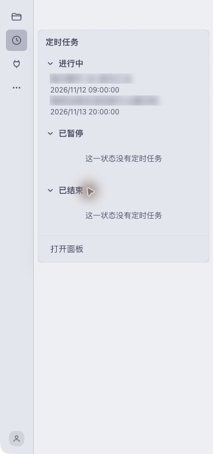</a></td>
    <td><a href="images/tasks-dark.png">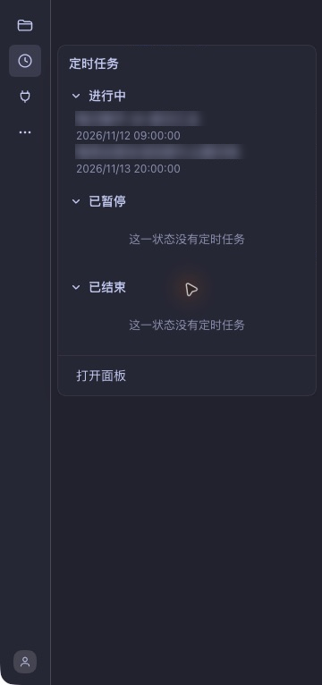</a></td>
  </tr>
</table>

## 我的插件

插件浮层有「已启用 / 未启用」两个分区。「未启用」指已经安装但关闭的用户插件；宿主内置包和未安装的推荐插件不列入。条目展示插件名称和可用的版本信息，空分区明确显示提示。

点击条目或「打开面板」进入宿主插件管理页。浮层内没有启停开关；安装、启用、停用和卸载均在宿主页面完成。

本轮显示 9 个已启用用户插件，未启用分区为空；两幅截图都保留版本、空态与「打开面板」。没有为采图改变其他插件的启停状态。

<table>
  <tr><th>浅色 · 插件两分区</th><th>深色 · 插件两分区</th></tr>
  <tr>
    <td><a href="images/plugins-light.png">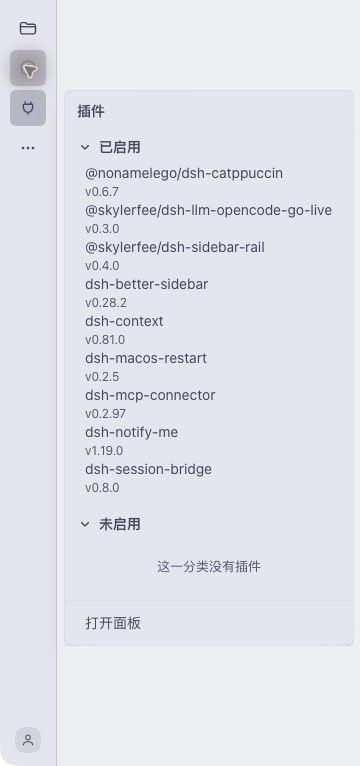</a></td>
    <td><a href="images/plugins-dark.png">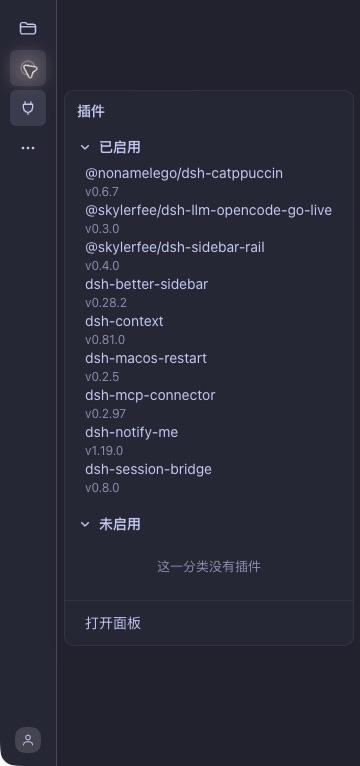</a></td>
  </tr>
</table>

## 更多入口

「更多」展示宿主提供的其他面板，例如当前 profile 注册的扩展面板；定时任务与插件已有专用入口，不重复列出。因此不同 profile 的内容可以不同。

「展开侧栏」恢复宿主完整侧栏，可继续使用原生搜索、工作区管理、账号菜单和设置入口。

<table>
  <tr><th>浅色 · 更多</th><th>深色 · 更多</th></tr>
  <tr>
    <td><a href="images/more-light.png">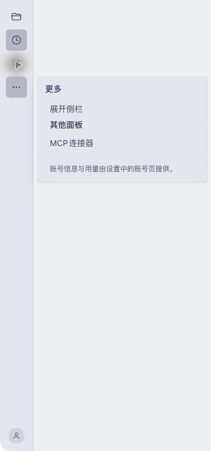</a></td>
    <td><a href="images/more-dark.png">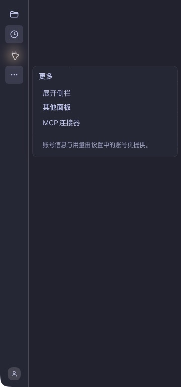</a></td>
  </tr>
</table>

## 账号与设置

底部使用宿主账号头像；头像不可用时显示占位图标。账号浮层按实际数据展示主余额、赠金及「查询用量」「充值」链接；主余额无法取得时显示「余额暂不可用」，这不表示余额为零。未登录时显示登录提示。

这些数据在组件挂载时读取，不保证实时刷新。链接在新窗口打开；登录、退出、充值和完整账号信息由宿主或目标网页处理。要打开设置，点「展开侧栏」，再点宿主左下角的设置入口。

本轮为已登录账号，截图包含余额 / 赠金标签、用量 / 充值链接及设置路径，金额已脱敏。没有打开付款流程，也未为了截图退出账号。

<table>
  <tr><th>浅色 · 账号与设置</th><th>深色 · 账号与设置</th></tr>
  <tr>
    <td><a href="images/account-light.png">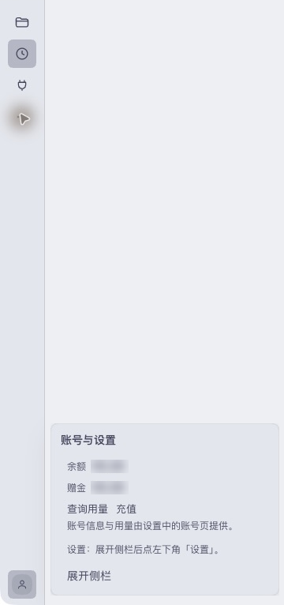</a></td>
    <td><a href="images/account-dark.png">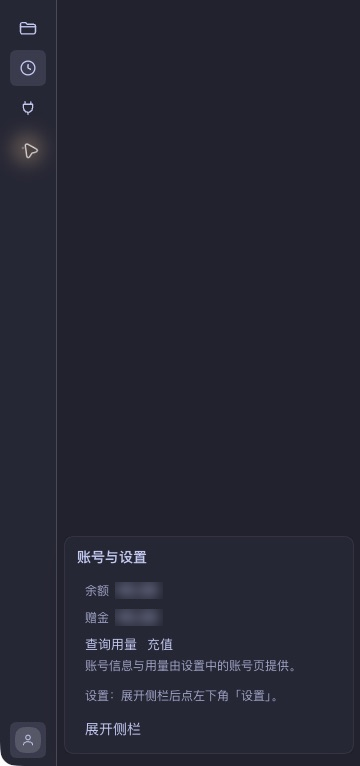</a></td>
  </tr>
</table>

## 键盘操作

| 按键 | 用途 |
| --- | --- |
| `Tab` / `Shift+Tab` | 在图标和可操作条目之间移动焦点，聚焦图标时唤出轨及对应浮层 |
| 顶部图标上的 `↓` / `→` | 进入对应浮层的首个可聚焦控件 |
| `Enter` / `Space` | 激活当前按钮；顶部图标激活后直接导航，项目行激活后展开或收起 |
| 浮层内 `Escape` | 预期关闭浮层并把焦点返回触发图标；当前实测限制见[验收报告](desktop-audit-2026-11-11.md) |

焦点在图标轨与浮层之间移动时应保持打开；焦点完全离开两者时应一起收起。系统设置为减少动态效果时，轨道滑动和浮层入场动画关闭。

## 本地数据与排障

偏好由当前客户端的 `localStorage['dsh.sidebar-rail.v1']` 保存，只写 `pinnedWorkspaceIds`（置顶项目）与 `expandedProjectIds`（展开项目）。宿主侧栏折叠状态由宿主保存，账号资料与余额不写入这份偏好。旧数据里的 `recentCount` 已不再读取。

| 现象 | 处理 |
| --- | --- |
| 看不到图标轨 | 激活 DSH，确认 macOS Desktop、已启用、侧栏折叠、宽度 ≥768px，再移入左缘热区 |
| 会话没在前 10 条里 | 滚到所属列表末尾点「显示更多」；同时检查空白、归档、子代理过滤规则 |
| 任务一直加载或时钟未出现 | 关闭浮层后重开，必要时进入宿主任务面板；当前快速切换缺陷见验收报告 |
| 添加项目失败 | 使用提示中的宿主添加路径；不把取消选择当作成功登记 |
| 「添加项目」弹出的对话框标题是英文 | 已知缺陷，插件层无法修复：标题由宿主硬编码（`Select Workspace Directory`），`NSOpenPanel.message` 不参与系统本地化。选定目录后仍能正常登记项目 |
| 余额或头像缺失 | 以宿主账号页为准；不要在问题反馈里附账号凭据或余额截图 |
| 插件影响导航 | 展开原生侧栏进入插件管理并停用，保留宿主版本、插件版本与复现步骤 |

截图只说明所拍场景的外观和内容；真实网络故障、未登录账号、所有会话状态及其他平台的验证范围，以[验收报告](desktop-audit-2026-11-11.md)为准。